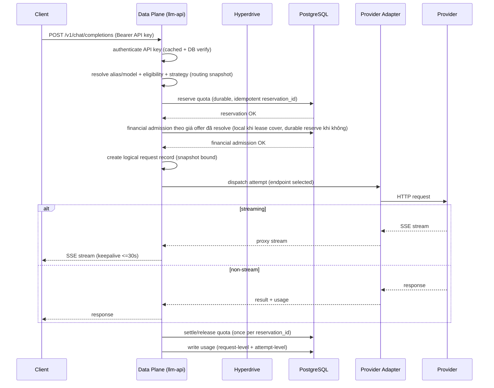
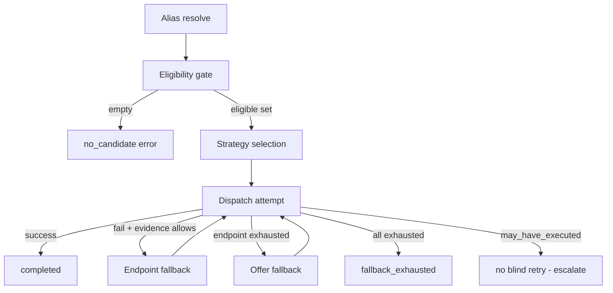
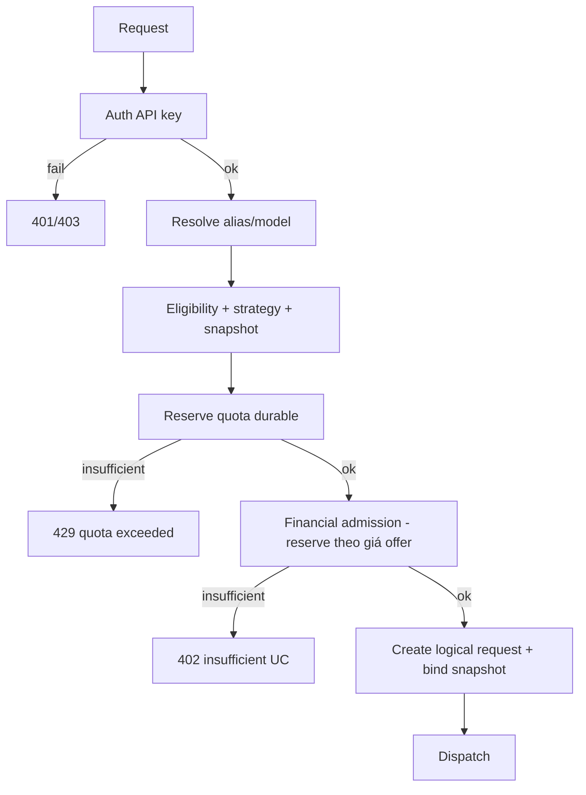
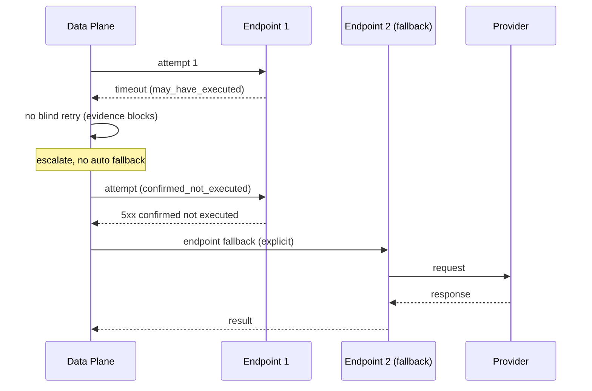
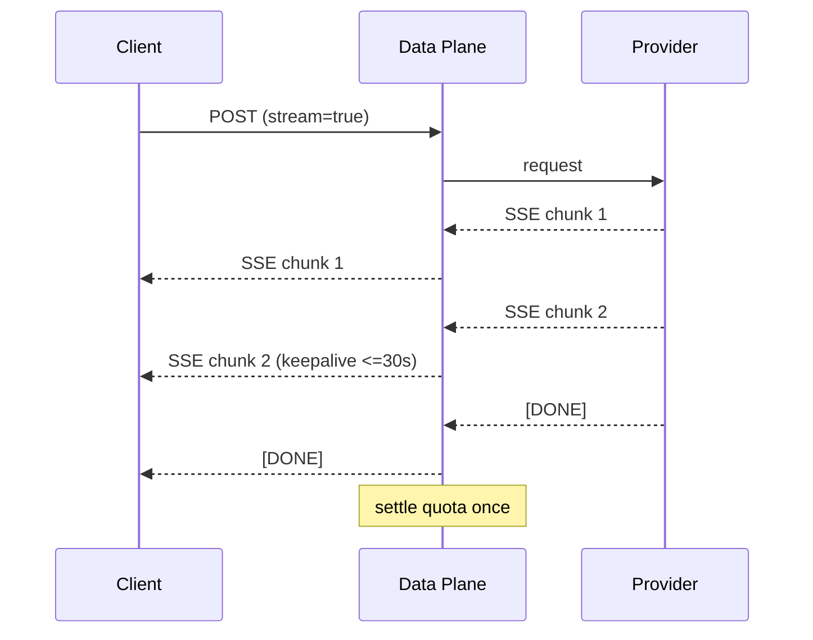
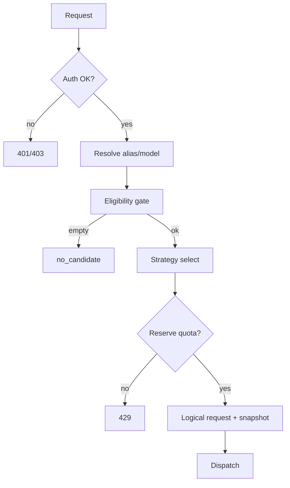

# llm-api — 01 Architecture

> Phạm vi: service design của deploy unit `llm-api` (control plane + data plane), boundary, runtime, data, dependencies, composition mapping. Target architecture.
> Yêu cầu → [`02-requirements.md`](./02-requirements.md) · vận hành → [`03-operations.md`](./03-operations.md) · system-level → [`docs/architecture/01-architecture.md`](../../architecture/01-architecture.md) · domain specs → [`docs/domains/llm-*`](../../domains/README.md).

---

## 1. Purpose & boundary

`llm-api` là **gateway suy luận LLM** công khai tại `api.ecoma.io/llm`. Nó là **quota authority và settlement authority** (A7, invariant 16): mọi `reserve` ghi bản ghi bền ngay khi giữ quota; `settle`/`release` idempotent theo `reservation_id`. PostgreSQL (`db-llm-gateway`) là nguồn sự thật duy nhất cho quota/usage/reservation/settlement.

**`llm-api` không sở hữu bất kỳ bounded context nào.** Nó host implementation của một số context bên trong deploy unit và tiêu thụ các context khác qua contract. Domain ownership luôn thuộc `docs/domains/*/domain-model.md`; `llm-api` chỉ triển khai runtime, persistence và enforcement, và pointer tới domain model khi cần business semantics.

**Sở hữu (runtime/persistence, không phải domain ownership):** API key, quota, usage, reservation, settlement, routing config, alias, pricing snapshot, provider endpoint pool (runtime view), execution journal, financial budget escrow/lease (theo `llm-financial`).

**Không sở hữu:** tenant/membership/workspace (→ `llm-consumer-tenant`), Seller tenant/ownership/membership/grant (→ `llm-seller-tenant`), restriction/appeal/verification/legal-tax profile/operational eligibility verdict (→ `llm-seller-governance`), seller offer/catalog/upstream endpoint canonical (→ `llm-marketplace`), ledger credit/payment (→ `payment`), payout workflow (→ `payout`), danh tính account (→ `account`).

---

## 2. Composition mapping — BC composed vs accessed via contract

| BC                      | Vai trò trong `llm-api`                                                                                                        | Access mode                                                      |
| ----------------------- | ------------------------------------------------------------------------------------------------------------------------------ | ---------------------------------------------------------------- |
| `llm-inference`         | Composed **inside** `llm-api` (lifecycle request, provider attempt, streaming, retry/fallback, execution evidence)             | internal module                                                  |
| `llm-consumer-routing`  | Composed **inside** `llm-api` (alias, candidate selection, fallback hai cấp, snapshot)                                         | internal module                                                  |
| `llm-usage`             | Composed **inside** `llm-api` (normalization, request/attempt usage, correction)                                               | internal module                                                  |
| `llm-seller-pricing`    | Composed **inside** `llm-api` (pricing snapshot bound at admission)                                                            | internal module                                                  |
| `llm-financial`         | Composed **inside** `llm-api` (budget escrow/lease, charge, payable, ledger view)                                              | internal module, nhưng reconciliation với `payment` qua contract |
| `llm-consumer-tenant`   | Composed **inside** `llm-api` (tenant, membership, workspace, grant, suspension); `llm-api` là storage owner `db-llm-tenant`   | internal module                                                  |
| `llm-marketplace`       | **Accessed via contract** — offer/normalized identity/endpoints là input cho routing; `llm-api` không đọc `db-llm-marketplace` | event projection (outbox)                                        |
| `llm-seller-governance` | **Accessed via contract** — eligibility/restriction verdict là giá trị hợp đồng; `llm-api` không đọc evidence pháp lý          | contract value                                                   |

**Quy tắc boundary:** `llm-consumer-tenant` là module trong cùng deploy unit — đọc/ghi `db-llm-tenant` qua module, không qua contract. `llm-marketplace` chỉ đọc projection đã đồng bộ (event-driven, idempotent consumer). Verdict của `llm-seller-governance` được tiêu thụ như giá trị hợp đồng, không import implementation. Không cross-database query. Quota/financial authority vẫn ở `llm-api` (A7) — không bị delegation.

**Extra service:** không đề xuất thêm service mới. Mọi BC trên đều là module trong cùng deploy unit `llm-api`. Chỉ tách thêm deploy unit khi có bằng chứng về scaling/ownership independence (chưa có). Ranh giới module-level enforce bằng Nx module-boundary + contract test.

---

## 3. Public API surfaces & planes

Hai plane trong cùng deploy unit:

```text
                    ┌─────────────────────────────┐
Client ──► public ──► │       Data Plane           │  (hot path, /llm/v1/...)
                    │  Rust high-perf runtime     │
                    └──────────────┬──────────────┘
                                   │ internal call
                    ┌──────────────▼──────────────┐
Admin/BFF ──► │       Control Plane          │  (admin API, config, audit)
                    │  (private, Service Binding) │
                    └──────────────┬──────────────┘
                                   │
                    ┌──────────────▼──────────────┐
                    │   PostgreSQL db-llm-gateway │  (Hyperdrive)
                    └─────────────────────────────┘
```

- **Data plane (public):** endpoint OpenAI-compatible (`/v1/chat/completions`, `/v1/completions`, `/v1/models`, `/v1/embeddings`), streaming SSE. Stateless, không query admin config per request ngoài cached snapshot.
- **Control plane (internal):** admin API quản lý API key, quota policy, alias/routing, pricing, provider endpoint, audit. Truy cập qua Service Binding (không public Internet) — caller phải auth ở app layer + tắt `workers_dev`.
- **Boundary:** data plane không thực hiện mutation admin; control plane không nằm trên hot path inference.

---

## 4. Request lifecycle (Mermaid sequence)



Terminal state: `completed` / `failed` / `cancelled`. Sau terminal không có attempt mới. Charge một lần per logical request.

---

## 5. Provider adapters

- Mỗi provider một adapter chuẩn hoá request shape, auth, streaming protocol, error mapping, và **execution evidence** classification.
- Adapter trả evidence cho mỗi attempt: `not_sent` / `may_have_executed` / `confirmed_completed` / `confirmed_not_executed`.
- Provider-specific usage format được chuẩn hoá ở `llm-usage` normalizer (versioned), không ở adapter.
- Adapter không log prompt/response body (privacy).

---

## 6. Model selection & endpoint selection

- **Alias resolution** trong admission: alias → model/capability. Không thay đổi sau dispatch.
- **Eligibility gate** trước strategy: active, capability match, health, quota/policy, tenant scope.
- **Strategy:** priority / round-robin / lowest customer price / weighted. Chỉ chọn trong tập eligible.
- **Endpoint selection:** availability, capability, health, policy. Không transparent switch giữa chừng request.

---

## 7. Routing strategies & fallback



- **Endpoint fallback** (cấp 1) và **Offer fallback** (cấp 2). Thứ tự: endpoint trước, rồi offer.
- Fallback chỉ khi routing còn candidate **và** `llm-inference` cho phép execution tiếp tục; `may_have_executed` → không retry tự động.
- **Financial re-admission khi fallback đổi offer (ADR-0028 §7.4):** attempt thay thế resolve snapshot giá mới cho chính offer đó rồi financial admission lại; offer thay thế **không kế thừa** giá offer gốc; thiếu UC cho giá mới ⇒ fail closed — không dispatch, không tạo attempt thay thế; evidence của attempt gốc giữ nguyên giá trị đã ghi.
- Không transparent provider switch sau khi đã stream bytes.

---

## 8. Pricing snapshots

- Pricing là versioned snapshot bound tại admission.
- Pricing change sau admission không alter admitted request price.
- Snapshot bind theo cặp request–offer: fallback đổi offer resolve snapshot mới cho offer thay thế (ADR-0028 §7.4); schedule change vẫn không alter giá đã admit.
- Customer price dùng cho strategy "lowest customer price" và charge calculation.
- Pricing snapshot persist cùng logical request record (audit/replay).

---

## 9. Retry/fallback classification

Bốn trạng thái evidence (sở hữu bởi `llm-inference` domain model):

| Evidence                 | Nghĩa                             | Retry?            |
| ------------------------ | --------------------------------- | ----------------- |
| `not_sent`               | Chưa gửi tới provider             | Có                |
| `may_have_executed`      | Có thể đã thực thi, chưa xác nhận | Không blind retry |
| `confirmed_completed`    | Provider xác nhận hoàn tất        | Không (đã xong)   |
| `confirmed_not_executed` | Provider xác nhận không thực thi  | Có                |

Adapter không chắc → `may_have_executed` (fail-safe). Timeout giữa dispatch và response → `may_have_executed` trừ khi provider trả xác nhận not-executed. HTTP status không phải evidence: chỉ semantics của provider mới chứng minh `confirmed_not_executed`.

Quyền retry do `llm-inference` quyết định qua một luật duy nhất; adapter và routing không được tự suy ra. Chi tiết và ma trận evidence → [`docs/domains/llm-inference/domain-model.md`](../../domains/llm-inference/domain-model.md) §4, §6.

---

## 10. Streaming semantics

- Proxy stream provider → client; không transparent switch sau khi stream bytes.
- SSE keepalive ≤ 30 s, không im lặng > 60 s (invariant 19).
- Client disconnect: logical request có thể tiếp tục hoặc cancel tuỳ policy; settlement theo provider result, không theo client connection. Disconnect là fact kết nối, không phải bằng chứng provider dừng và không phải cancellation; policy "tiếp tục hay cancel" chưa chốt (`docs/domains/llm-inference/domain-model.md` §12, U-2).
- Partial output không leak; stream kết thúc cleanly.

---

## 11. Quota admission (Mermaid)



- Reserve durable ngay khi giữ quota (A7). Không fallback KV làm sai quota.
- **Financial admission (ADR-0028 §5):** sau khi snapshot giá đã resolve, trước dispatch; kiểm coverage theo applicable price của offer sẽ phục vụ — budget lease còn cover ⇒ local atomic admission (không DB call per request, §12), không cover (ví dụ fallback sang offer đắt hơn) ⇒ durable financial reserve; financial reservation id riêng, liên kết quota reservation qua `request_id`. Admission fail ở bước nào → trả lỗi ngay, không dispatch, không tạo attempt.
- Idempotent theo `reservation_id`.

---

## 12. Budget reservation & leases (financial)

Theo `llm-financial` domain model:

- **Budget escrow:** tiền earmark cho consumer trong khoảng thời gian.
- **Budget lease:** cấp consumer/key ngân sách liên tục (amount per window) với `epoch`/`fencing_token`. Admission financial dùng bounded escrow/leases + local atomic admission; **không** gọi DB/coordinator per inference request.
- **Reservation (financial):** giữ tiền trong wallet (escrow): `available -= amount; held += amount`. Idempotent theo `reservation_id`.
- **Nguồn funding wallet:** deposit từ `payment` hoặc sponsor grant có funding authorization với trần sponsor + per-billing-account — kiểm tại thời điểm cấp trong `llm-financial` (ADR-0028 §4–§5); admission chỉ tiêu số dư `available`, không có bypass cho tenant `first_party`.
- **Phân biệt reservation ID:** quota reservation và financial reservation dùng **hai ID khác nhau** (quota `reservation_id` ≠ financial `reservation_id`); execution journal liên kết cả hai qua `request_id`. Không dùng một ID chung để đánh tráo hai loại reservation.
- **Capture** khi dùng: `held -= amount; charged += amount`. **Release** khi unused.
- Lease expiry không chứng minh gateway cũ dừng tiêu → cần fencing epoch/token + reconciliation trước reallocation.
- Escrow conservation: `available + held + charged = total` per wallet (total = tổng tiền đã nạp; release trả vào available, capture chuyển held → charged).

---

## 13. Execution journal

- Mỗi logical request và attempt được ghi bền: `request_id`, `reservation_id`, alias, resolved model, routing snapshot version, endpoint, start/end time, evidence, usage.
- Mỗi attempt ghi thêm `offer_ref`, `seller_tenant_ref`, `pricing_snapshot_ref` của chính attempt đó (ADR-0028 §8) — điều kiện tái dựng giá và seller obligation per-attempt khi một logical request đi qua nhiều offer.
- Attempt-level usage phục vụ audit/reconciliation; không nhân lên charge.
- Journal là nguồn cho reconciliation, correction, và post-incident analysis.
- Không log prompt/response body.

---

## 14. Usage processing handoff

- Usage measurement (đo lường) ≠ financial charge (tính tiền). Usage là dữ liệu đo lường; charge là quyết định tài chính.
- Normalization deterministic + versioned (bump version khi thay normalizer).
- Token categories: `input_tokens`, `output_tokens`, `cached_tokens` (≤ input), `reasoning_tokens`.
- Missing/malformed provider usage → ghi `usage_status = missing/malformed`, không silently coi là 0; alert + reconcile.
- Request-level usage = cơ sở cho settlement/charge. Attempt-level = audit/reconciliation.
- Idempotent theo `reservation_id` (request-level) và `(attempt_id, correction_id)`.

---

## 15. Financial correctness

- Double-entry ledger: mọi transaction debit = credit.
- Non-negative balance (trừ overdraft được cấp phép rõ ràng).
- Settlement idempotent theo `reservation_id`: không duplicate charge.
- Customer charge = f(usage, customer price, discount); khác provider cost (chi phí thực) và seller payable.
- Seller payable ≠ payout (payout có thể delay/adjustment).
- Seller payable chỉ accrue cho seller có nghĩa vụ settle thật — seller **không** liên kết `FirstPartyLegalPrincipal` Ecoma-io (bất kể trạng thái principal — trạng thái chỉ điều khiển serving eligibility, ADR-0027 §5); seller first-party không accrue payable, không EC, không payout (ADR-0028 §7.1).
- Reconciliation: đối soát `llm-financial` ledger, `payment` ledger, `llm` usage/reservation, provider invoice. Mismatch → alert + audit, không tự sửa số liệu.
- Customer charge tính từ customer price (seller-configured, `llm-seller-pricing`) trừ discount/fee; provider cost là đại lượng độc lập, ownership/source chưa chốt (`docs/domains/open-boundaries.md` OB-7).

---

## 16. Failure model

- **PostgreSQL down:** fail closed cho request mới (503 + Retry-After); stream đang chạy hoàn tất → settlement debt. Không circuit-breaker để phục vụ khi settlement không bền.
- **Provider failure:** retry/fallback theo evidence; `may_have_executed` không blind retry.
- **Client disconnect:** settlement theo provider result.
- **Missing usage:** không block completion nếu policy cho phép; ghi durable + alert.
- **No-candidate:** trả lỗi tường minh, không dispatch, release reservation nếu đã reserve.

---

## 17. Observability

- Correlation ID xuyên client → Worker → provider → DB.
- Metrics: cache hit/miss (n/a), auth failure, backend error, quota conservation violation (`settled + active_reservation > grant` — lỗi correctness), settlement backlog age, unsettled usage, 5xx ratio, stream keepalive.
- Không log prompt/response body; chỉ metadata (xoá sau 90 ngày).
- Telemetry không bao giờ là production dependency.
- Axiom dataset tách theo env; traceparent xuyên hop.

---

## 18. Runtime/deployment boundary

- **Runtime:** Rust high-performance (WASM/Worker) cho data plane; control plane có thể Rust hoặc TypeScript. PostgreSQL authoritative; Hyperdrive cho Worker (query cache OFF).
- **VPS runtime (nếu có):** direct connection approved topology cho runtime ngoài Worker (không bắt buộc Hyperdrive); nhưng Worker path bắt buộc Hyperdrive. Một Cloudflare account mọi env.
- **Database:** `db-llm-gateway`, PostgreSQL, TimescaleDB nếu cần cho usage time-series. Migration expand → compatible rollout → contract.
- **Secrets:** native Worker Secrets theo env; không vào Git/PR/Preview.

---

## 19. Mermaid — provider fallback



---

## 20. Mermaid — streaming



---

## 21. Mermaid — quota admission



---

## 22. Mermaid — financial reservation/settlement

```mermaid
sequenceDiagram
  participant DP as Data Plane
  participant W as Wallet (DB)
  participant L as Ledger

  DP->>W: reserve amount (idempotent reservation_id)
  W->>W: available -= amount; held += amount
  W-->>DP: reserved
  Note over DP: dispatch + stream
  DP->>W: settle usage
  W->>W: held -= amount; charged += amount
  W->>L: post charge entry (debit=credit)
  L-->>W: posted
  W-->>DP: settled (once per reservation_id)
```

---

## 23. Invariants (service-level)

1. Quota/settlement authority ở PostgreSQL; không fallback KV (A7, invariant 16).
2. Logical request charged once, dù nhiều attempt.
3. No blind retry after possible execution.
4. No transparent provider switch after stream bytes.
5. Routing snapshot immutable per logical request.
6. Eligibility gate trước strategy.
7. SSE keepalive ≤ 30 s, no silence > 60 s.
8. Escrow conservation: `available + held + charged = total`.
9. Settlement idempotent theo `reservation_id`.
10. Tenant/workspace id từ principal, không từ client input.

---

## 24. Tài liệu

| Document                                     | Nội dung                                                                         |
| -------------------------------------------- | -------------------------------------------------------------------------------- |
| [`README.md`](./README.md)                   | Ứng dụng `llm-api`, composition mapping, persistence, execution state, lifecycle |
| [`01-architecture.md`](./01-architecture.md) | Service design, boundary, runtime, data, dependencies, composition mapping (này) |
| [`02-requirements.md`](./02-requirements.md) | Functional/non-functional requirements và non-goals của deploy unit              |
| [`03-operations.md`](./03-operations.md)     | Deployment, configuration, monitoring, failure, recovery, runbook                |
