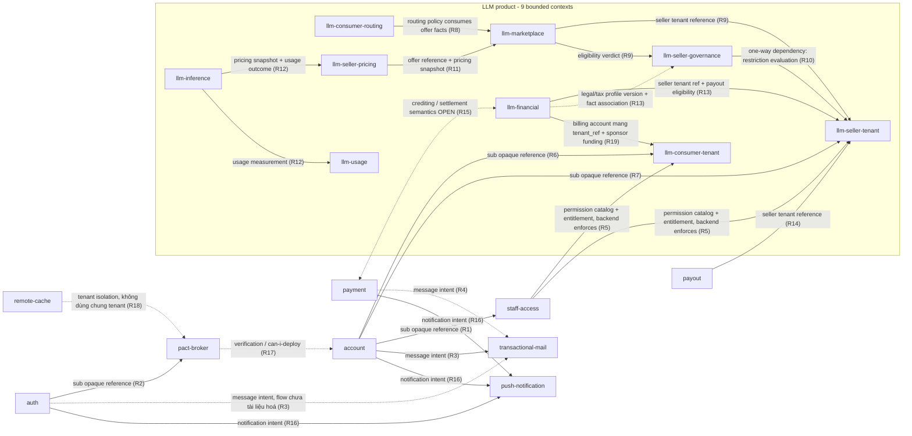

# Context Map

> **Phạm vi:** quan hệ **ngữ nghĩa** giữa các bounded context trong kiến trúc đích. Chỉ mô tả quan hệ nghiệp vụ và DDD relationship pattern; **không** mô tả service binding, HTTP, queue, worker hay deployment graph.
>
> Catalog bounded context → [`README.md`](./README.md). Ngôn ngữ → [`glossary.md`](./glossary.md). Ranh giới chưa chốt → [`open-boundaries.md`](./open-boundaries.md). Background job không bao giờ là bounded context hay một quan hệ domain.

## 1. Quy ước

Pattern dùng trong tài liệu này:

| Pattern                | Nghĩa trong Ecoma                                                                                                                                                                                          |
| ---------------------- | ---------------------------------------------------------------------------------------------------------------------------------------------------------------------------------------------------------- |
| **Opaque reference**   | Context downstream giữ tham chiếu opaque (`sub`, `seller_tenant_id`, `reservation_id`) tới dữ liệu của context upstream. Không phải foreign key xuyên database; toàn vẹn thuộc contract và reconciliation. |
| **Customer/Supplier**  | Downstream tiêu thụ một contract do upstream công bố; upstream không phụ thuộc downstream.                                                                                                                 |
| **Published language** | Upstream công bố một ngôn ngữ/contract ổn định mà nhiều downstream cùng tiêu thụ.                                                                                                                          |
| **Conformist**         | Downstream chấp nhận model của upstream mà không dịch lại.                                                                                                                                                 |
| **ACL**                | Downstream đặt lớp chống tham nhũng để dịch model của upstream sang model của mình.                                                                                                                        |
| **Partnership**        | Hai context phối hợp hai chiều trên một capability chung, mỗi bên vẫn sở hữu model của mình.                                                                                                               |

Bảng quan hệ ở §3 là **canonical**; sơ đồ §2 chỉ minh hoạ và không thêm quan hệ.

## 2. Sơ đồ

Mũi tên `payment ↔ llm-financial` được đánh dấu **OPEN** — xem [`open-boundaries.md`](./open-boundaries.md), không kết luận về hướng gọi hay nguồn sự thật. Quan hệ giữa các `llm-*` tuân bất biến chiều phụ thuộc của [ADR-0019](./llm-consumer-tenant/adr/0019-llm-scope-ownership-and-dependency-matrix.md): Consumer không trỏ tới Seller và ngược lại; Shared không trỏ tới Consumer hay Seller. Vì vậy `llm-seller-pricing` (Seller) và `llm-consumer-routing` (Consumer) chỉ gặp nhau qua price facts do Application cấp, không qua edge code.

## 3. Bảng quan hệ (canonical)

| #   | Quan hệ                                                                                                                                                                                                                                              | Pattern                                | Ý nghĩa ngữ nghĩa                                                                                                                                                                                                                                                                                                                                                               | Nguồn                                                      |
| --- | ---------------------------------------------------------------------------------------------------------------------------------------------------------------------------------------------------------------------------------------------------- | -------------------------------------- | ------------------------------------------------------------------------------------------------------------------------------------------------------------------------------------------------------------------------------------------------------------------------------------------------------------------------------------------------------------------------------- | ---------------------------------------------------------- |
| R1  | `account` → `staff-access`                                                                                                                                                                                                                           | Opaque reference (customer/supplier)   | `staff-access` liên kết staff member bằng `sub`. Là tham chiếu, không phải quan hệ sở hữu; trạng thái staff độc lập với trạng thái account (invariant 31).                                                                                                                                                                                                                      | A21, invariant 7                                           |
| R2  | `auth` → `pact-broker`                                                                                                                                                                                                                               | Opaque reference                       | Broker dùng `sub` từ access token do `auth` phát hành. Tenant mặc định được provision tường minh, không tự động khi signup/login.                                                                                                                                                                                                                                               | `domains/pact-broker`                                      |
| R3  | `account`/`auth` → `transactional-mail`                                                                                                                                                                                                              | Customer/Supplier                      | Hai context tạo message intent cho mail control plane. Luồng email-OTP của `account` đã có tài liệu; luồng của `auth` mới ở mức consumer.                                                                                                                                                                                                                                       | `domains/transactional-mail`, `domains/account`            |
| R4  | `payment` → `transactional-mail`                                                                                                                                                                                                                     | Customer/Supplier                      | `payment` là consumer của mail control plane; chi tiết template/flow chưa tài liệu hoá.                                                                                                                                                                                                                                                                                         | `domains/transactional-mail`                               |
| R5  | `staff-access` ↔ resource-owning contexts (`llm-consumer-tenant`, `llm-consumer-routing`, `llm-seller-tenant`, `llm-seller-governance`, `llm-marketplace`, `llm-seller-pricing`, `llm-inference`, `llm-usage`, `llm-financial`, `payment`, `payout`) | Published language (catalog govern)    | `staff-access` công bố permission catalog, staff-role assignment và product entitlement; resource-owning backend tự enforce trên mọi protected request và sở hữu grant nội bộ sản phẩm của mình. Không có verdict allow/deny theo từng request.                                                                                                                                 | A21–A24, ADR-0009, ADR-0014                                |
| R6  | `account` → `llm-consumer-tenant`                                                                                                                                                                                                                    | Opaque reference                       | Consumer tenant liên kết account bằng `sub`; account chỉ sở hữu shared identity, LLM tự sở hữu tenant/membership/authorization của Consumer.                                                                                                                                                                                                                                    | A21, `domains/llm-consumer-tenant`                         |
| R7  | `account` → `llm-seller-tenant`                                                                                                                                                                                                                      | Opaque reference                       | Seller tenant liên kết account bằng `sub`; `llm-seller-tenant` tự sở hữu tenant/ownership/membership/authorization của Seller. Seller tenant độc lập với Consumer tenant.                                                                                                                                                                                                       | ADR-0018, `domains/llm-seller-tenant`                      |
| R8  | `llm-consumer-routing` → `llm-marketplace`                                                                                                                                                                                                           | Customer/Supplier (qua Application)    | Routing chọn offer từ facts về offer/capability; không sở hữu offer hay endpoint. Candidate eligibility đến trước strategy.                                                                                                                                                                                                                                                     | `domains/llm-consumer-routing`, `domains/llm-marketplace`  |
| R9  | `llm-marketplace` → `llm-seller-tenant` (seller tenant reference) · `llm-marketplace` → `llm-seller-governance` (eligibility/verification verdict)                                                                                                   | Opaque reference + Customer/Supplier   | Marketplace giữ `seller_tenant_id` trên offer và tiêu thụ operational eligibility/verification; không sở hữu Seller identity, ownership hay restriction.                                                                                                                                                                                                                        | `domains/llm-marketplace`, `domains/llm-seller-governance` |
| R10 | `llm-seller-governance` → `llm-seller-tenant`                                                                                                                                                                                                        | Conformist (một chiều)                 | Governance được phép phụ thuộc một chiều vào tenant để tham chiếu tenant/membership và xuất restriction evaluation; tenant khai báo lại shape tại biên và không import implementation. Chiều ngược lại bị cấm.                                                                                                                                                                  | ADR-0018                                                   |
| R11 | `llm-seller-pricing` → `llm-marketplace`                                                                                                                                                                                                             | Customer/Supplier                      | Pricing gắn schedule với offer và giữ pricing snapshot bất biến; seller-configured price **là** customer price. Không sở hữu offer lifecycle.                                                                                                                                                                                                                                   | `domains/llm-seller-pricing`                               |
| R12 | `llm-inference` → `llm-seller-pricing`, `llm-inference` → `llm-usage`                                                                                                                                                                                | Customer/Supplier + Published language | Inference dùng pricing snapshot đã chốt cho một logical request và phát usage measurement; không tự tính giá hay tự quyết định charge.                                                                                                                                                                                                                                          | `domains/llm-inference`, `domains/llm-usage`               |
| R13 | `llm-financial` → `llm-seller-tenant` (seller tenant ref + payout eligibility) · `llm-financial` → `llm-seller-governance` (legal/tax profile version + fact association `FirstPartyLegalPrincipal`)                                                 | Customer/Supplier (qua contract)       | Financial đọc Seller tenant reference, legal/tax profile version hiệu lực, **fact association** (seller có liên kết `FirstPartyLegalPrincipal` Ecoma-io hay không — input entitlement payable, ADR-0028 §7.1) và payout verdict để tính withholding/accounting; không sở hữu profile. Đây là quan hệ contract, không phải edge code — Shared không phụ thuộc Seller (ADR-0019). | `llm-financial/adr/0008`, `llm-seller-governance/adr/0006` |
| R14 | `payout` → `llm-seller-tenant`                                                                                                                                                                                                                       | Opaque reference                       | Payout giữ `seller_tenant_id` trên payout request và tiêu thụ payout eligibility; không sở hữu Seller tenant hay permission của Seller.                                                                                                                                                                                                                                         | `domains/payout`                                           |
| R15 | `payment` ↔ `llm-financial`                                                                                                                                                                                                                          | **OPEN** — chưa xác định               | Phân chia trách nhiệm đã chốt: `payment` sở hữu payment transaction và payout execution; `llm-financial` sở hữu LLM monetary state. Hợp đồng payment outcome (idempotent event/API) **chưa chốt** → [`open-boundaries.md`](./open-boundaries.md).                                                                                                                               | A7, `domains/payment`                                      |
| R16 | `account`/`auth`/`payment` → `push-notification`                                                                                                                                                                                                     | Customer/Supplier                      | Các context này phát notification intent; routing và quyết định recipient chỉ ở `push-notification`. Quan hệ mới ở mức producer intent.                                                                                                                                                                                                                                         | `domains/push-notification`                                |
| R17 | `pact-broker` ↔ verified services                                                                                                                                                                                                                    | Partnership                            | Broker lưu pact, ghi nhận verification và trả `can-i-deploy` tri-state fail-closed. Broker **ghi nhận** deployment, không thực hiện deployment thật.                                                                                                                                                                                                                            | `domains/pact-broker`                                      |
| R18 | `remote-cache` ↔ `pact-broker`                                                                                                                                                                                                                       | Separate ways (tenant độc lập)         | Hai context sở hữu hai hệ tenant/membership tách biệt hoàn toàn; không suy ra tenant hay membership của nhau.                                                                                                                                                                                                                                                                   | ADR-0015                                                   |
| R19 | `llm-financial` → `llm-consumer-tenant`                                                                                                                                                                                                              | Opaque reference                       | Billing account mang `tenant_ref` (beneficiary/workspace) và `owner_ref` (`sub`, provenance); sponsor funding và trần chi tiêu thuộc `llm-financial` (ADR-0028). Không FK xuyên DB; classification, membership, authorization vẫn thuộc consumer-tenant — không suy hai chiều.                                                                                                  | ADR-0028, `llm-financial/domain-model.md` §2               |

### 3.1 Quan hệ được xem xét nhưng chưa có tài liệu hậu thuẫn

Các quan hệ sau **không** được vẽ thành arrow vì tài liệu hiện tại chưa hậu thuẫn đủ. Không suy ra chúng:

- `payment` → `account` (sub reference cho payout recipient?) — chưa có tài liệu.
- Mapping `account` ↔ các context LLM còn lại (workspace ↔ account?) — Seller đã chốt ở R7, Consumer tenant ở R6; các context khác chưa có tài liệu.
- Direct call giữa `payment` và LLM product — chưa kết luận là có hay không; R15 giữ mở.
- Chi tiết flow notification intent cho `payment` (trigger, payload, idempotency) — mới ở mức producer.

Khi một quan hệ được tài liệu hoá, cập nhật bảng §3 và [`open-boundaries.md`](./open-boundaries.md) cùng lúc.
